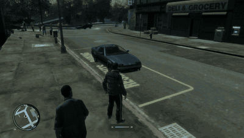

# libfpv


*(example with [sm64ex-fpv](https://github.com/hammerill/sm64ex-fpv))*



*(another one with [gtaiv-fpv](https://github.com/hammerill/gtaiv-fpv))*

A drop-in FPV quadcopter for any game. libfpv runs real Betaflight firmware
(through [SimITL](https://github.com/AJ92/SimITL)) on its own 1 kHz
simulation thread, reads the player's radio or gamepad, and gives the game
everything it needs to draw one rendered frame: the drone's pose, the FPV,
chase and line-of-sight cameras, motor RPMs, impacts, a Betaflight OSD, a
settings overlay and motor sound.

The game supplies collision geometry and draws the result. libfpv has no
renderer of its own, and its API is plain C, so it can be loaded from any
engine or mod loader.

## Features

- **Betaflight in the loop.** The firmware is real Betaflight 2025.12, so
  rates, modes, filters and arming behave as they do on a real quad. Betaflight
  Configurator can connect over WebSocket (`ws://localhost:5761`). The Betaflight
  CLI is available in-process, and `diff all` from a real quad can be imported.
- **Physics presets.** Frame, motor, propeller, battery, VTX and camera are
  set in JSON presets (`assets/presets/`), with a separate EEPROM for each quad.
- **Collisions.** The game provides static meshes, moving objects or a
  raycast callback, and libfpv reports impacts and prop damage.
- **Input.** Radios and gamepads are read through an embedded, hidden SDL3,
  with a radio setup wizard (arm, angle, beeper and turtle switches).
  Keyboard and gamepad fallbacks are included.
- **Presentation.** The OSD uses Betaflight's MAX7456 fonts (analog or HD
  look). A Dear ImGui overlay opens on F8, and synthesized motor sound comes
  through `fpv_audio_read`. Both the OSD and the overlay are returned as
  textured triangles, so one small renderer draws both.
- **Camera.** Uptilt and FOV are adjustable, and there is a fisheye lens
  (on by default). Analog video noise grows with range and with obstacles in
  the way.

## Building

Requirements: CMake 3.24 or newer, a C11/C++17 compiler (GCC or Clang), and
the usual X11/Wayland and audio development headers for SDL3 on Linux. On
macOS the Xcode command line tools are enough.

```sh
git clone --recursive https://github.com/hammerill/libfpv.git
cd libfpv
cmake -S . -B build/linux
cmake --build build/linux -j
ctest --test-dir build/linux
```

If you cloned without `--recursive`, run `git submodule update --init`
first. The SimITL and Betaflight patches in `patches/` are applied
automatically at configure time.

The default build type is `Release`. Outputs in the build directory:

| File | What it is |
|---|---|
| `libfpv.so` (`libfpv.dylib` on macOS, `libfpv.dll` + `libfpv.def` on Windows) | the library |
| `examples/fpv_standalone` | a small SDL3 + OpenGL 3.3 game that uses every libfpv hook |
| `examples/fpv_minimal` | the smallest headless integration |
| `tests/fpv_tests` | the test suite |

### Options

| Option | Default | |
|---|---|---|
| `LIBFPV_WITH_SDL` | `ON` | Read radios and gamepads with the embedded SDL3 |
| `LIBFPV_WITH_OVERLAY` | `ON` | Build the Dear ImGui overlay |
| `LIBFPV_BUILD_TESTS` | `ON` | Build the test suite |
| `LIBFPV_BUILD_EXAMPLES` | `ON` | Build the examples |

### Windows

Windows builds are cross-compiled from Linux with MinGW-w64 (install the
`-posix` variant). All runtimes are linked statically, so `libfpv.dll`
depends only on Windows system DLLs:

```sh
cmake -S . -B build/win -DCMAKE_TOOLCHAIN_FILE=cmake/toolchains/mingw-w64-x86_64.cmake
cmake --build build/win -j
```

For 32-bit games (such as GTA IV), use `cmake/toolchains/mingw-w64-i686.cmake`
with `-B build/win32` instead.

MSVC hosts can make an import library with `lib /def:libfpv.def /machine:x64`
or load the DLL with `LoadLibrary`.

### macOS

macOS builds natively with Apple Clang (tested on Apple Silicon):

```sh
cmake -S . -B build/mac
cmake --build build/mac -j
ctest --test-dir build/mac
```

Hidden symbols keep the embedded SDL3's C functions private, but
Objective-C classes share one global namespace. If the game also links
SDL3, the Objective-C runtime warns that classes such as `SDL3Window` are
implemented twice, and which copy is used is undefined. `fpv_standalone`
shows these warnings because it links its own SDL3 on purpose. To avoid the
duplicate classes, build with `-DLIBFPV_WITH_SDL=OFF` and pass input in
with `fpv_input_set_channels`.

### Sanitizers

```sh
cmake -S . -B build/asan -DCMAKE_BUILD_TYPE=Debug \
  -DCMAKE_C_FLAGS="-fsanitize=address -fno-omit-frame-pointer" \
  -DCMAKE_CXX_FLAGS="-fsanitize=address -fno-omit-frame-pointer"
```

## Trying it out

```sh
./build/linux/examples/fpv_standalone
```

| Key | Action |
|---|---|
| F8 | libfpv overlay (preset, radio setup, rates, camera, Betaflight CLI) |
| V | Camera: FPV / chase / line of sight |
| R | Repair and respawn |
| F11 or Alt+Enter | Fullscreen |
| Esc | Quit |

Without a radio, use the keyboard: Enter arms, W/S is throttle, A/D is yaw
and the arrow keys pitch and roll (self-level). T toggles turtle mode: to
flip a crashed drone back over, turn it on, arm, hold an arrow key until
it lands upright, then turn turtle off to fly away. Settings, EEPROMs and the
selected preset are stored in `./libfpv-data` (change it with
`--data <dir>`).

## Integrating into a game

```c
fpv_global_config cfg;
fpv_global_config_defaults(&cfg);
cfg.data_dir = "<writable folder>";
cfg.coords = fpv_coords_preset(FPV_COORDS_Y_UP_RIGHT_HANDED, 1.0f);
fpv_global_init(&cfg);                        // once

fpv_static_surfaces_load(&level_mesh, 1);     // world collision
fpv_drone *d;
fpv_drone_create(NULL, &d);                   // spawn

// every frame
fpv_drone_tick(d, dt, &frame);
// place the game camera at frame.camera, draw the drone at frame.position /
// frame.rotation, then draw fpv_osd_draw_data() and fpv_overlay_render()

fpv_global_terminate();                       // on unload / exit
```

- `include/libfpv.h`: the whole API, documented inline (threading, memory
  ownership, ABI rules).
- `docs/INTEGRATION.md`: integration details, such as the fisheye
  post-process shader.
- `docs/renderers/fpv_render_gl3.h`: a single-header OpenGL 3.3 / ES 3.0
  renderer for the OSD and the overlay.
- `examples/standalone/main.cpp`: a complete integration, with a comment at
  the top listing every hook in order.
- `docs/DECISIONS.md`: why things are the way they are.

## Repository layout

```
include/      public C API (libfpv.h)
src/          library: sim/, config/, input/, world/, osd/, overlay/, audio/
assets/       presets and OSD fonts (embedded into the library at build time)
patches/      patch series applied to the SimITL and Betaflight submodules
third_party/  SimITL, Betaflight, libwebsockets, fmt, SDL, Dear ImGui, nlohmann/json
examples/     fpv_minimal and fpv_standalone
tests/        test suite and real-quad `diff all` fixtures
cmake/        core build, file embedding, toolchains, symbol export lists
```

## License

GPL-3.0-or-later. libfpv embeds Betaflight, so any mod or program that links
it must be distributed under GPL-3.0-compatible terms. See [LICENSE](LICENSE)
for the full text.
